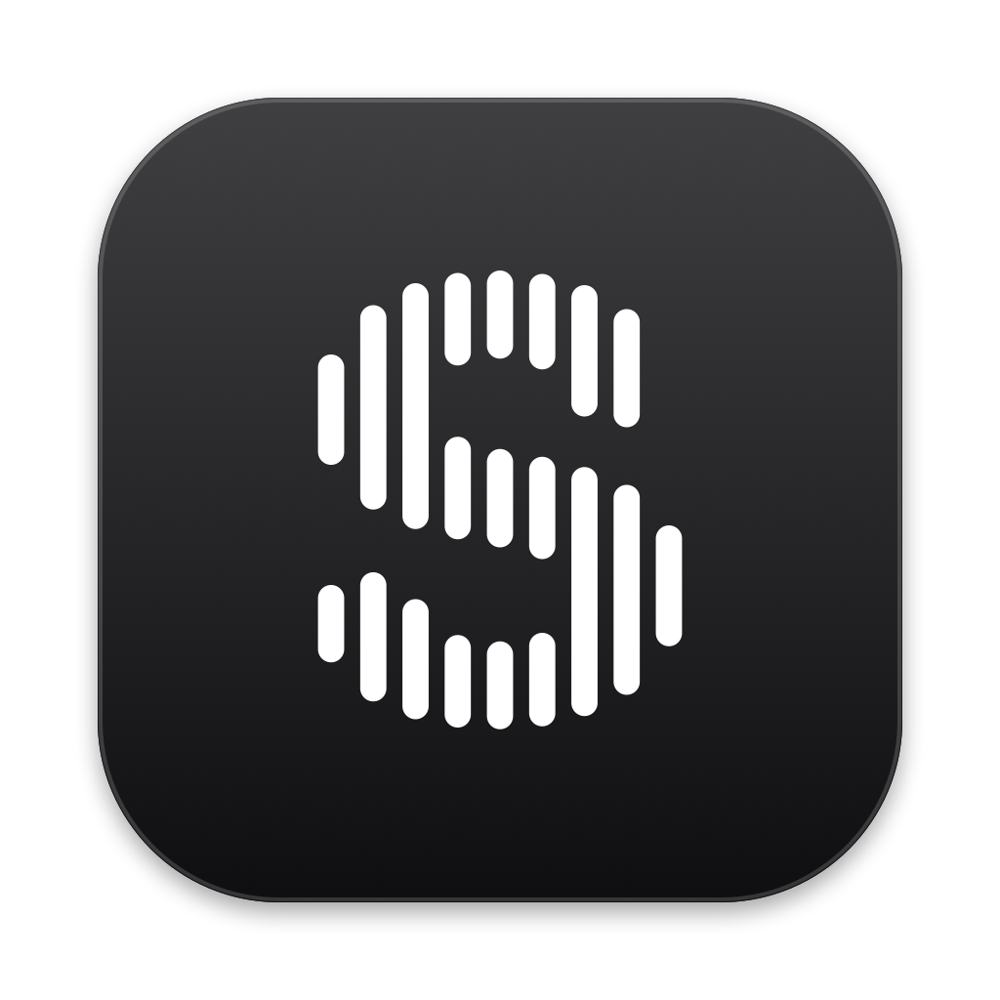
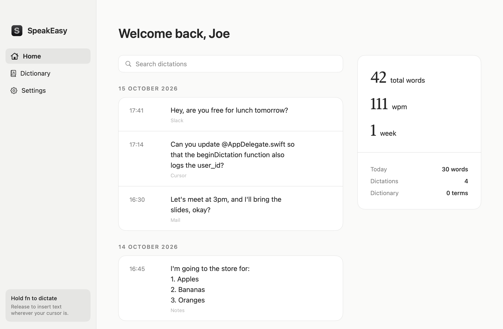
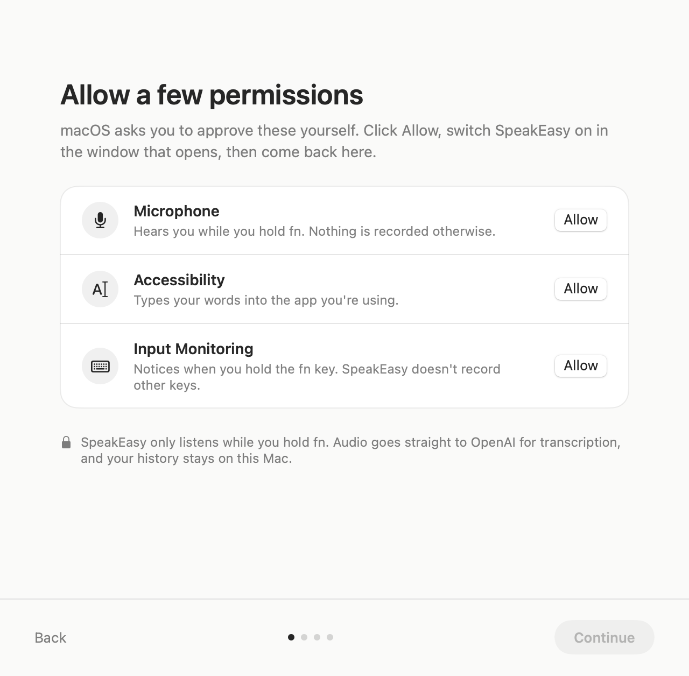

<p align="center">
  
</p>

<h1 align="center">SpeakEasy</h1>

<p align="center">
  Hold <kbd>fn</kbd>, talk, let go. Your words appear wherever you're typing.<br>
  Open-source voice dictation for macOS, powered by OpenAI.
</p>

<p align="center">
  
</p>

## Install

Paste this into Terminal:

```bash
curl -fsSL https://raw.githubusercontent.com/joepreyer/speakeasy/main/scripts/install.sh | bash
```

SpeakEasy installs into Applications and opens a setup assistant that walks you through the rest in about a minute. You'll need macOS 13 or later and an [OpenAI API key](https://platform.openai.com/api-keys).

<details>
<summary>Other ways to install</summary>

**Download the app.** Grab `SpeakEasy.dmg` from the [latest release](https://github.com/joepreyer/speakeasy/releases/latest) and drag SpeakEasy into Applications. Releases aren't notarized by Apple yet, so the first time you open it macOS says it can't verify the developer. Click **Done**, then go to **System Settings → Privacy & Security** and click **Open Anyway**. The Terminal install above skips this step.

**Build from source.** Requires Xcode 15 or later.

```bash
git clone https://github.com/joepreyer/speakeasy.git
cd speakeasy
./build.sh
open build/SpeakEasy.app
```

</details>

## What it does

- **Dictate anywhere.** Hold fn in any text field, speak, and release. A small waveform at the bottom of the screen shows it's listening.
- **Clean writing, not a raw transcript.** Filler words disappear, self-corrections are applied ("at 2... actually 3" becomes "at 3"), spoken punctuation works ("comma", "new line"), and spoken lists become numbered lists.
- **Built for developers.** In code editors and terminals, SpeakEasy keeps commands and identifiers exact, handles "camel case" and "snake case", spells tools like Supabase and Vercel correctly, and tags files you mention as `@File.swift` in Cursor and Windsurf.
- **A dictionary that learns.** Add names and jargon yourself, or just fix a misspelled word right after dictating it and SpeakEasy remembers.
- **History.** Every dictation is saved on your Mac, searchable by day, with word count and speaking-speed stats.

<p align="center">
  
</p>

## Permissions and privacy

The setup assistant asks for three macOS permissions and explains each one:

<p align="center">
  
</p>

| Permission | Why |
| --- | --- |
| Microphone | Records your voice, only while you hold fn. |
| Accessibility | Pastes the text into the app you're using, and notices spelling fixes for the dictionary. |
| Input Monitoring | Detects when you hold fn. Other keys aren't recorded. |

Audio goes directly from your Mac to OpenAI for transcription (`gpt-transcribe`) and formatting (`gpt-6-luna`), using your own API key. There's no SpeakEasy server. Your key is stored in the macOS Keychain, and your history and dictionary stay in `~/Library/Application Support/SpeakEasy`.

## Uninstall

```bash
curl -fsSL https://raw.githubusercontent.com/joepreyer/speakeasy/main/scripts/uninstall.sh | bash
```

This removes the app, its login item, and its permissions, then asks whether to delete your history, dictionary, and saved API key too.

## Contributing

Pull requests are welcome. See [CONTRIBUTING.md](CONTRIBUTING.md) for how to build, test, and send changes.

## License

[MIT](LICENSE)
